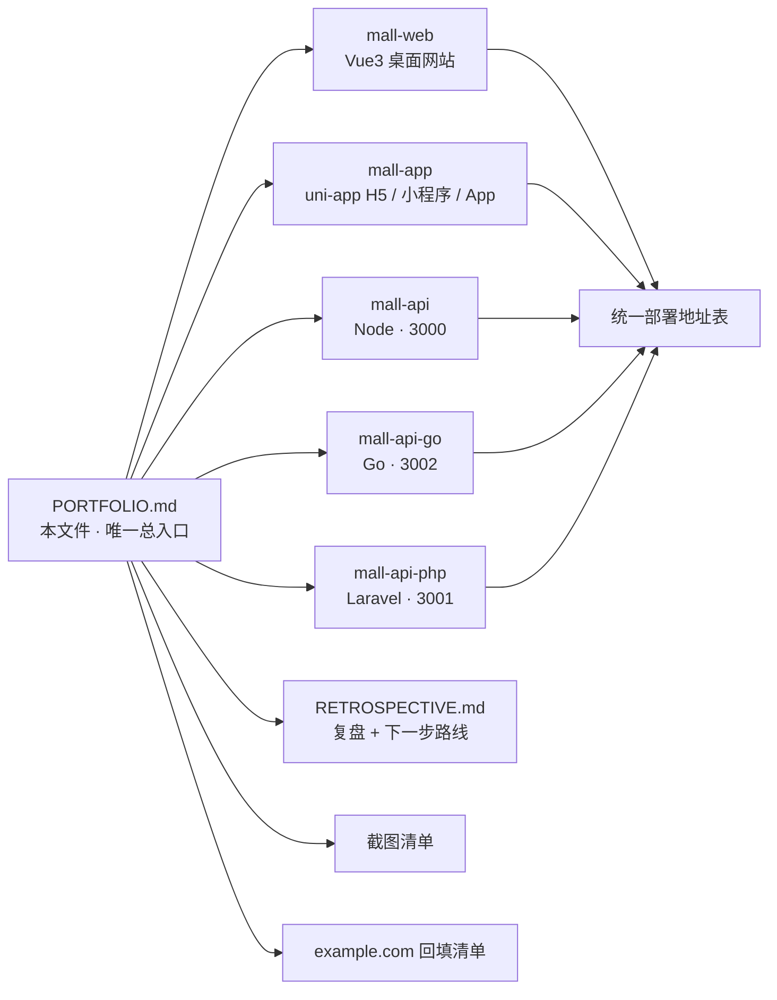
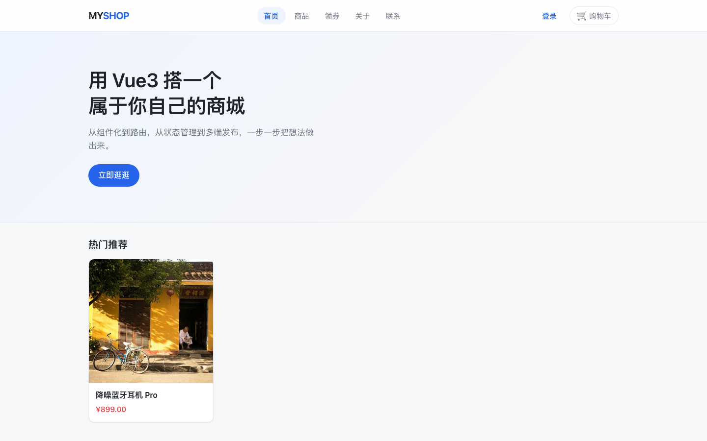

# Mall 全栈商城作品集总览

> D27 作品集入口。状态：**当前未部署、按降级交付**。  
> 本文件位于 `mall-web` 仓库根目录，受 Git 管理；跨仓库链接均为 GitHub 代码仓库链接，**未联网验证**、**不是部署地址**。

## 0. 一句话介绍

用 4 周时间从前端页面、Node/Express/Prisma 后端，扩展到一个 uni-app 多端商城，并用 Go/Gin 与 PHP/Laravel 各复刻一套接口完全兼容的后端；最终交付「2 个前端 + 3 套后端」的可本地运行学习项目。



## 1. 项目速览

| 角色 | 仓库 / 路径 | 技术栈 | 本地端口 | 包管理 / 启动方式 |
|---|---|---|---|---|
| 桌面网站 | `mall-web`（本仓库） | Vue 3 + Vite + Vue Router + Pinia + Element Plus | 5173 | **pnpm** |
| 多端商城 | `mall-app` | uni-app Vue3 → H5 / 微信小程序 / Android App | 5173 | **npm** |
| 主后端 | `mall-api` | Node 20 + Express 5 + Prisma 6 + MySQL 8 | 3000 | **pnpm** |
| Go 后端 | `mall-api-go` | Go + Gin + sqlx | 3002 | 本机 `go run .` |
| PHP 后端 | `mall-api-php` | PHP 8.3 + Laravel 11 + Query Builder | 3001 | **Docker Compose**，本机不装 PHP |

三套后端共用同一个 MySQL 库、同一份 JWT 密钥、同一套 `{ code, message, data }` 响应信封和 46 条路由；前端只改 `VITE_API_BASE` 即可切换后端。

### 图片 URL 契约（简述）

- 数据库只存相对路径 `/uploads/xxx.png`。
- 接口一律返回完整 URL，前端跨域部署不依赖 `/uploads` 代理。
- origin 优先取 `PUBLIC_ORIGIN`，留空则按当前请求推导。
- 三套后端共用 `backend/uploads/`，该目录**不在任何 Git 仓库内**。
- 完整契约见本地 `backend/README.md` 图片 URL 章节；该文件不在 Git 仓库内，仅本地可读。

## 2. 部署地址（当前未部署）

> 用户已确认「不打算部署到线上」，因此本表按降级规则填写。**零编造 URL**，不写「已上线 / 可在线体验」。

| 字段 | 地址 | 状态 | 来源 |
|---|---|---|---|
| Web 桌面网站 | 待填 | 当前未部署 | 用户提供或自行部署后回填 |
| H5 商城 | 待填 | 当前未部署 | 用户提供或自行部署后回填 |
| API · Node | 待填（本地 `http://localhost:3000/api`） | 当前未部署 | 用户提供或自行部署后回填 |
| API · Go | 待填（本地 `http://localhost:3002/api`） | 当前未部署 | 用户提供或自行部署后回填 |
| API · PHP | 待填（本地 `http://localhost:3001/api`） | 当前未部署 | 用户提供或自行部署后回填 |
| 微信小程序 | 待填 | 当前未部署 / 未提交审核 | 用户提供或自行部署后回填 |
| Android APK | 待填 | 当前未部署 / 未打包分发 | 用户提供或自行部署后回填 |
| 代码仓库 | 见下表 | **不是部署地址** | 现有 README / 用户提供 |

### 代码仓库（未联网验证，非部署地址）

| 项目 | 地址 | 备注 |
|---|---|---|
| mall-web | `https://github.com/ndotsc/mall-web` | 现有 README 第 3 行 badge 推断，未联网验证 |
| mall-app | `https://github.com/ndotsc/mall-app` | 现有 README 第 3 行 badge 推断，未联网验证 |
| mall-api | `https://github.com/ndotsc/mall-api` | 现有 README / 部署文档引用，未联网验证 |
| mall-api-go | 待补（来源：用户提供） | 现有文档未记录 GitHub 地址，不按组织名推测拼接 |
| mall-api-php | 待补（来源：用户提供） | 现有文档未记录 GitHub 地址，不按组织名推测拼接 |

## 3. 部署文档索引

> 用户约定「部署步骤与命令放各项目根目录 `deploy.md` 小写」。本轮**不擅自改名、不新建跳转文件**，只登记现状。

| 仓库 | 现有文件 | 状态 |
|---|---|---|
| `mall-web` | 暂无独立 `deploy.md` | 本地运行见本仓库 README；生产部署未执行，无内容可写 |
| `mall-app` | 暂无独立 `deploy.md` | 本地运行见 `mall-app/README.md`；H5 / 小程序 / APK 打包步骤见 `mall-api/DEPLOY.md` §6 |
| `mall-api` | `DEPLOY.md`、`DEPLOY-CN.md` | 大写命名；含付费项汇总与上线总验收清单，本轮保持原样 |
| `mall-api-go` | `deploy.md` | 小写，符合约定 |
| `mall-api-php` | `deploy.md` | 小写，符合约定 |

付费部署结论保持 `mall-api/DEPLOY.md` §7 原样：12 行付费项表中 10 项 ⏸ 跳过、2 项 ✅ 已文档化 / 无需；§8 上线总验收清单未勾选。

## 4. 截图

用户确认：**截图放两个前端仓库、无需打码**。本轮已在本机启动 dev server、连接已运行的 `mall-api` / MySQL，用无头 Chrome 抓取了 6 张真实页面截图；未部署、未付费、未生成假图。

### 已截图

| 端 | 页面 | 文件 | 状态 | 来源 |
|---|---|---|---|---|
| Web | 首页 | `mall-web/docs/screenshots/web-home.png` | 已截图 | 本机 `pnpm dev` + headless Chrome |
| Web | 商品列表 | `mall-web/docs/screenshots/web-products.png` | 已截图 | 同上 |
| Web | 商品详情 | `mall-web/docs/screenshots/web-product-detail.png` | 已截图 | 同上 |
| Web | 登录页 | `mall-web/docs/screenshots/web-login.png` | 已截图 | 同上 |
| H5 | 首页 | `mall-app/docs/screenshots/app-h5-home.png` | 已截图 | 本机 `npm run dev:h5` + headless Chrome |
| H5 | 商品详情 | `mall-app/docs/screenshots/app-h5-detail.png` | 已截图 | 同上 |

预览：




> 第二个预览是本地跨仓库相对路径，仅在本地目录结构中可达；推送到 GitHub 后请改为 `mall-app` 仓库内的相对引用或绝对 raw 链接。

### 待补截图清单

| 端 | 页面 | 建议文件 | 状态 | 来源 |
|---|---|---|---|---|
| Web | 购物车 / 结算 / 订单成功 | `mall-web/docs/screenshots/web-cart.png` 等 | 待补 | 用户本地登录后截取 |
| Web | 后台商品 / 文章管理 | `mall-web/docs/screenshots/web-admin.png` 等 | 待补 | 用户本地用 `admin/admin123` 登录后截取 |
| Web | 个人中心 / 地址 / 收藏 / 优惠券 | `mall-web/docs/screenshots/web-profile.png` 等 | 待补 | 用户本地截取 |
| H5 | 购物车 / 确认订单 / 我的 / 订单 | `mall-app/docs/screenshots/app-h5-cart.png` 等 | 待补 | 用户本地截取 |
| 微信小程序 | 首页 / 详情 / 下单闭环 | `mall-app/docs/screenshots/mp-*.png` | 待补 | 微信开发者工具真机调试截取 |
| Android App | 首页 / 详情 / 下单闭环 | `mall-app/docs/screenshots/app-*.png` | 待补 | HBuilderX 云打包后真机截取 |

本地启动命令只列给用户自行执行，不在此处运行：

```bash
# mall-web
cd /Users/baichuan/development/projects/frontend/vue/mall-web
pnpm install
pnpm dev

# mall-app H5
cd /Users/baichuan/development/projects/frontend/uni-app/mall-app
npm install
npm run dev:h5

# 三套后端任选其一，默认 mall-api 已在 3000 提供数据
cd /Users/baichuan/development/projects/backend/mall-api
pnpm install
pnpm dev
```

## 5. `example.com` 占位回填清单

当前没有真实域名，**10 处绝对 URL 保持 `https://example.com` 不变**，只统一了注释措辞。拿到真实域名后，按下面 18 个引用点一次性替换 / 改写；禁止全局替换后端契约示例。

| # | 仓库 | 路径 | 修改前定位 | 类型 |
|---|---|---|---|---|
| 1 | mall-web | `index.html` | 原 :15 canonical | URL |
| 2 | mall-web | `index.html` | 原 :22 og:url | URL |
| 3 | mall-web | `index.html` | 原 :23 og:image | URL |
| 4 | mall-web | `index.html` | 原 :10 注释 | 注释 |
| 5 | mall-web | `public/robots.txt` | 原 :16 Sitemap | URL |
| 6 | mall-web | `public/robots.txt` | 原 :2 注释 | 注释 |
| 7 | mall-web | `public/sitemap.xml` | 原 :7 首页 loc | URL |
| 8 | mall-web | `public/sitemap.xml` | 原 :12 /products loc | URL |
| 9 | mall-web | `public/sitemap.xml` | 原 :17 /about loc | URL |
| 10 | mall-web | `public/sitemap.xml` | 原 :22 /contact loc | URL |
| 11 | mall-web | `public/sitemap.xml` | 原 :2 注释 | 注释 |
| 12 | mall-app | `index.html` | 原 :12 注释（无绝对 URL） | 注释 |
| 13 | mall-app | `public/robots.txt` | 原 :7 Sitemap | URL |
| 14 | mall-app | `public/robots.txt` | 原 :3 注释 | 注释 |
| 15 | mall-app | `public/sitemap.xml` | 原 :7 首页 loc | URL |
| 16 | mall-app | `public/sitemap.xml` | 原 :2 注释 | 注释 |
| 17 | mall-web | `README.md` | 原 :62 D27 待办 | README 待办 |
| 18 | mall-app | `README.md` | 原 :75 D27 待办 | README 待办 |

> 坐标为 D27 修改前行号，仅用于定位。回填时还要同步：两 README 部署地址表、本文件部署地址表、截图清单引用、复盘文档中的部署状态描述。

**明确不改的后端的 `example.com`**：`backend/README.md`、两份 `backend-overview.md`、`mall-api/DEPLOY.md`、`mall-api/DEPLOY-CN.md`、`mall-api/API.md`、`mall-api-go/deploy.md`、`mall-api-php/deploy.md`、`mall-api-go/README.md` 等文件中的均为接口契约 / 配置示例 / 测试夹具，替换会破坏语义。

## 6. 关联文档

| 文档 | 位置 | 说明 |
|---|---|---|
| 本文件 | `mall-web/PORTFOLIO.md` | 唯一作品集总入口 |
| 复盘与下一步路线 | `mall-web/RETROSPECTIVE.md` | D1–D26 复盘 + 学习计划 §10 五条进阶路线，只规划不实现 |
| Web 项目说明 | `mall-web/README.md` | 8 章节作品集结构 |
| 多端项目说明 | `mall-app/README.md` | 8 章节作品集结构 |
| 后端说明 | `mall-api/README.md`、`mall-api-go/README.md`、`mall-api-php/README.md` | 各加一句定位 + 回链 |
| 接口契约 | `mall-api/API.md`、各后端 `docs/openapi.json` | 46 条路由、统一响应信封 |
| 部署文档 | 见第 3 节索引表 | 保持现有命名，不改名 |

跨仓库链接策略：本仓库内部用相对链接；其它仓库回链到本文件时使用 GitHub 绝对链接，并标注「未联网验证 / 非部署地址」。`backend/README.md` 因不在任何 Git 仓库内，只做文字引用。

## 7. 范围与边界

- 已纳入：`mall-web`、`mall-app`、`mall-api`、`mall-api-go`、`mall-api-php`。
- 排除：`backend/mall-server/`、`frontend/vue/day01/`、`projects/ai/` 等历史目录。
- 本轮 D27 改动只涉及文档、HTML 注释、robots / sitemap 注释与新增截图；**不动业务代码、`.env`、lock 文件、数据库、Git 历史**。
- 不部署、不付费、不 push、不生成假地址、不开始 §10 进阶实现。
