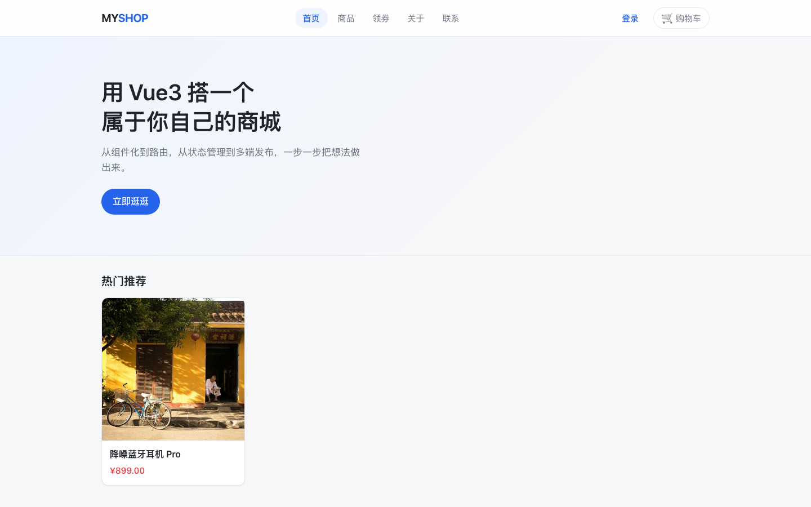

# mall-web

> 桌面 / 移动浏览器版商城前端。作品集总入口见 [PORTFOLIO.md](./PORTFOLIO.md)，四周复盘与下一步路线见 [RETROSPECTIVE.md](./RETROSPECTIVE.md)。


> 上面是 CI badge / 代码仓库信息，**未联网验证、不是部署地址**。

## 1. 定位

`mall-web` 是「前端全栈 4 周冲刺」里的项目 A：Vue 3 + Vite 的响应式网站，覆盖品牌首页、商品浏览、搜索筛选、购物车、下单、收藏、评价、优惠券、个人中心与后台管理。它和 `mall-app`（uni-app 多端商城）共用同一套后端接口，可切换 Node / Go / PHP 三套兼容实现。

## 2. 技术栈

| 层 | 选型 |
|---|---|
| 框架 | Vue 3 `<script setup>`、Vue Router 5、Pinia 4 |
| UI | Element Plus |
| 构建 | Vite 8，`@vitejs/plugin-vue` |
| HTTP | Axios，统一 `{ code, message, data }` 响应拦截 |
| 包管理 | **pnpm**（本仓库是 `pnpm-lock.yaml`） |
| SEO | 静态 meta / OG / canonical + 路由级动态 title / description |
| 后端 | `mall-api` 3000 / `mall-api-go` 3002 / `mall-api-php` 3001，任选其一 |

## 3. 功能清单

- 前台：首页、商品列表（关键词 / 分类 / 价格 / 排序）、商品详情、关于我们、联系我们。
- 交易：登录 / 注册、购物车、收货地址、确认订单、优惠券、订单成功、我的订单、订单详情。
- 用户：个人中心、我的收藏、我的优惠券、领券中心、商品评价。
- 后台：管理员登录、商品 CRUD、文章 CRUD、图片上传。
- 体验：图片懒加载 / 失败兜底、上传前压缩、骨架屏、公开 GET 缓存、错误态重试、404、全局异常兜底、vendor chunk。

## 4. 架构与目录

```
mall-web/
├── PORTFOLIO.md              # D27 作品集总入口
├── RETROSPECTIVE.md          # D27 复盘 + 下一步路线
├── index.html                # 静态 SEO / OG / canonical
├── public/
│   ├── robots.txt
│   └── sitemap.xml
├── docs/screenshots/         # D27 真实页面截图
├── src/
│   ├── api/                  # Axios 封装 + 业务接口模块
│   ├── components/           # PageSkeleton / ErrorState / SiteHeader / SiteFooter
│   ├── directives/image.js   # v-img：懒加载 / eager / 失败兜底
│   ├── router/index.js       # 路由、守卫、SEO meta
│   ├── stores/               # Pinia：user / cart / ...
│   ├── utils/                # auth / image / seo
│   └── views/                # 页面组件
└── vite.config.js            # dev proxy + 构建分包
```

开发代理：`/api`、`/uploads` → `http://localhost:3000`。生产跨域部署时接口返回完整图片 URL，`PUBLIC_ORIGIN` 优先，前端不必依赖 `/uploads` 代理。

## 5. 本地运行

> 命令只列给你自己执行；D27 没有代跑安装 / 构建 / 测试。

```bash
cd /Users/baichuan/development/projects/frontend/vue/mall-web
pnpm install
pnpm dev         # http://localhost:5173
pnpm build       # dist/
pnpm preview
```

后端任选其一，默认使用已启动的 `mall-api`：

```bash
cd /Users/baichuan/development/projects/backend/mall-api
pnpm install
pnpm dev         # http://localhost:3000
```

切换后端只改 `.env` 的 `VITE_API_BASE`，例如 `http://localhost:3002/api`（Go）或 `http://localhost:3001/api`（PHP）。

## 6. 接口与契约

- 统一响应：成功 `{ code: 0, message: "ok", data: ... }`，失败 `{ code: <HTTP状态码>, message: "...", data: null }`。
- 金额：接口与数据库用整数「分」，页面展示除以 100 转「元」。
- 鉴权：token 存 `localStorage`，请求拦截器自动带 `Authorization: Bearer <token>`；401 清 token 并跳 `/login?redirect=...`。
- 管理员：`/admin` 需要 `role === 2`；seed 账号 `admin / admin123`。
- 图片：库内存 `/uploads/xxx.png`，接口返回完整 URL；三套后端共用 `backend/uploads/`；完整契约见 [PORTFOLIO.md](./PORTFOLIO.md) 第 1 节。
- 完整接口清单：`mall-api/API.md` 或 `GET /api/docs`。

## 7. 部署地址（当前未部署）

> 用户已确认不部署到线上；下表按「未部署 / 待补」降级交付，零编造 URL。

| 字段 | 地址 | 状态 | 来源 |
|---|---|---|---|
| Web 桌面网站 | 待填 | 当前未部署 | 用户提供或自行部署后回填 |
| H5 商城 | 待填 | 当前未部署 | 用户提供或自行部署后回填 |
| API · Node | 待填（本地 `http://localhost:3000/api`） | 当前未部署 | 用户提供或自行部署后回填 |
| API · Go | 待填（本地 `http://localhost:3002/api`） | 当前未部署 | 用户提供或自行部署后回填 |
| API · PHP | 待填（本地 `http://localhost:3001/api`） | 当前未部署 | 用户提供或自行部署后回填 |
| 微信小程序 | 待填 | 当前未部署 / 未提交审核 | 用户提供或自行部署后回填 |
| Android APK | 待填 | 当前未部署 / 未打包分发 | 用户提供或自行部署后回填 |
| 代码仓库 | `https://github.com/ndotsc/mall-web`（未联网验证） | **不是部署地址** | 现有 badge |

`index.html` / `robots.txt` / `sitemap.xml` 中的 `https://example.com` 仍是占位；拿到真实域名后按 [PORTFOLIO.md](./PORTFOLIO.md) 第 5 节的 18 点清单一次性回填。**不要全局替换后端契约示例。**

## 8. 截图

用户确认截图放前端仓库、无需打码。本轮已在本机启动 dev server 并用无头 Chrome 抓取真实页面：

| 页面 | 文件 |
|---|---|
| 首页 | [web-home.png](./docs/screenshots/web-home.png) |
| 商品列表 | [web-products.png](./docs/screenshots/web-products.png) |
| 商品详情 | [web-product-detail.png](./docs/screenshots/web-product-detail.png) |
| 登录页 | [web-login.png](./docs/screenshots/web-login.png) |



购物车、结算、订单、后台、个人中心等需要登录态的截图列入 [PORTFOLIO.md](./PORTFOLIO.md) 第 4 节「待补截图清单」，由用户本地启动后补图。

## 9. D26 体验优化摘要

| 项 | 实现 |
|---|---|
| 图片 | `v-img` 指令统一 13 处 ``；`imageUrl()` 预留 CDN 参数；后台上传前 `compressImage()` 等比缩放 + JPEG 重编码 |
| 骨架屏 | `PageSkeleton.vue` 的 grid / list / detail 三种形状，尊重 `prefers-reduced-motion` |
| 接口缓存 | `src/api/request.js` 只缓存公开 GET；TTL 60s；同 key 并发复用同一个 Promise；登录态不缓存；写操作清缓存 |
| 错误兜底 | 全局 `errorHandler`、`router.onError`、`unhandledrejection`、资源 error 捕获；`ErrorState.vue` 区分请求失败与空数据 |
| SEO / 构建 | 静态 + 路由级 meta、私有页 `noindex`、`robots.txt` / `sitemap.xml`、Vue / Element Plus vendor chunk |

## 10. 已知边界

- 纯 SPA：爬虫只能看到静态 meta 与空 `#app`；真 SEO 需要 Nuxt 3 / SSR 或构建期预渲染。
- `sitemap.xml` 只列静态路由，商品详情 `/product/:id` 需预渲染后才能枚举。
- history 模式部署后需要 Nginx `try_files $uri $uri/ /index.html`。
- 前端内存缓存不取消在途 GET，极端时序下旧请求可能回填旧数据；进阶可加 `cacheEpoch` 或 `AbortController`。
- 服务端图片重编码、HTTP `Cache-Control` / ETag、Redis 共享缓存属于 [RETROSPECTIVE.md](./RETROSPECTIVE.md) 的进阶路线，当前未实现。

## 11. 关联导航

| 目标 | 链接 / 路径 | 状态 |
|---|---|---|
| 作品集总览 | [./PORTFOLIO.md](./PORTFOLIO.md) | 同仓库相对链接 |
| 复盘与路线 | [./RETROSPECTIVE.md](./RETROSPECTIVE.md) | 同仓库相对链接 |
| mall-app | `https://github.com/ndotsc/mall-app` | 代码仓库，未联网验证、非部署地址 |
| mall-api | `https://github.com/ndotsc/mall-api` | 同上 |
| mall-api-go | 待补（来源：用户提供） | 不按组织名推测 |
| mall-api-php | 待补（来源：用户提供） | 不按组织名推测 |
| 后端本地总览 | `backend/README.md` | 不在任何 Git 仓库内，仅本地可读 |

> 本仓库 D26 与 D27 文档当前只有本地提交 / 未提交状态，跨仓库 GitHub 回链需等对应仓库 push 后才生效。
